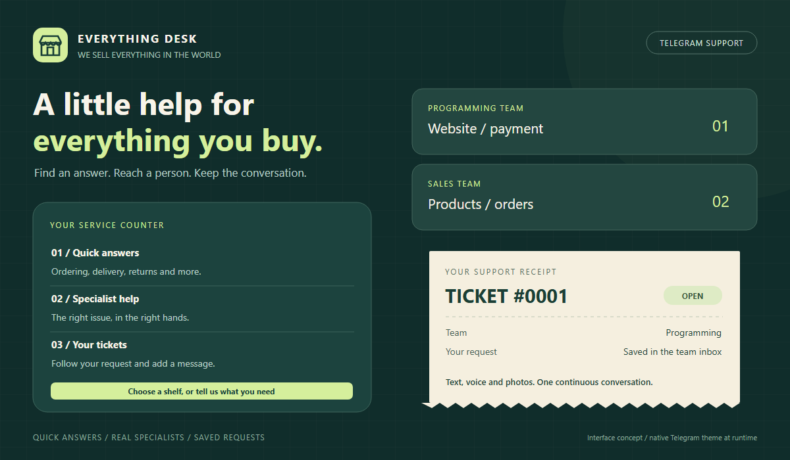

# Everything Desk

**A little help for everything you buy.**

A Telegram support bot for **We Sell Everything In The World**, written for Python **3.11.7+**. Customers get instant answers, practical troubleshooting and a clear route to the right specialist. Administrators get a persistent support inbox directly in Telegram.



*Design illustration of the bot's information hierarchy. The running bot uses native Telegram messages and buttons; colors, fonts and chat backgrounds follow the customer's Telegram theme.*

## What is included

| Requirement | Implementation |
| --- | --- |
| Automatic FAQ answers | All six supplied questions and answers, unchanged; buttons and common English text phrasings |
| Solutions to common issues | A Fix-it Shelf for website, payment and login problems; relevant guides also appear with typed requests |
| Two specialist departments | Programming handles website/payment issues; Sales handles products/orders; customers can change the suggested team |
| Database integration | Every confirmed escalation has a row in `specialist_requests`; messages and notification delivery are stored separately |
| Text messages | Questions, ticket descriptions, follow-ups and specialist replies |
| Voice bonus | Customer and staff voice notes are stored by Telegram file ID and relayed, without paid APIs or transcription |
| Damage evidence | Photos with optional captions, including specialist photo replies |
| Friendly interface | Numbered desk sections, inline menus, request previews, ticket cards and paginated inboxes |
| Administration | Restricted team inboxes, replies, resolution, reopening, setup mode and this operating guide |

No AI API key, web server or external database server is required. A Telegram bot token, internet access and a running Python process are required for live use.

## Quick start: Windows / PyCharm Community Edition

1. Create a bot through [BotFather](https://t.me/BotFather), using `/newbot`. Keep the token private.
2. Clone this repository and open its folder in PyCharm:

   ```bash
   git clone https://github.com/DanielFot/Technical-Support-TG-Bot.git
   cd Technical-Support-TG-Bot
   python -m venv .venv
   ```

3. In PyCharm, select `.venv\Scripts\python.exe` as the project interpreter. In PowerShell, install dependencies and copy the configuration:

   ```powershell
   .\.venv\Scripts\python.exe -m pip install -r requirements.txt
   Copy-Item .env.example .env
   ```

   In Git Bash, the equivalent is:

   ```bash
   .venv/Scripts/python.exe -m pip install -r requirements.txt
   cp .env.example .env
   ```

   On Linux/macOS, use `.venv/bin/python` in place of the Windows interpreter path.

4. Edit `.env` and set `BOT_TOKEN`. To discover staff IDs before the teams are configured, run:

   ```powershell
   .\.venv\Scripts\python.exe app.py --setup
   ```

   Have each administrator and specialist open the bot's **private chat** and send `/start`. Setup mode replies with their own numeric Telegram user ID. It does not create support tickets. Stop it with **Ctrl+C**.

5. Set the authorized IDs in `.env`. These numbers are examples; replace them:

   ```dotenv
   BOT_TOKEN=your_botfather_token
   ADMIN_IDS=111111111
   PROGRAMMING_IDS=222222222,333333333
   SALES_IDS=444444444
   DATABASE_PATH=data/support.db
   ```

   Administrators can access both departments and receive both teams' notifications. A single administrator can cover both teams during a course demonstration; department lists may then be empty. Without an administrator, both department lists must be configured. IDs must be positive **user IDs**, not usernames or group IDs.

6. Run `app.py` in PyCharm, or:

   ```powershell
   .\.venv\Scripts\python.exe app.py
   ```

   Open the bot and send `/start`. The SQLite database and its folder are created automatically. Relative database paths and `.env` are resolved from the project folder, even if PyCharm uses a different working directory.

Only run **one polling process per bot token**. Stop setup mode before normal mode. Everyone receiving notifications must have started the bot and must not have blocked it. The bot stays online while its process and internet connection are running; GitHub stores the source and does not host the running bot.

## Customer guide

- **Quick answers:** browse the six FAQ buttons or type a question such as `Where is my order?`. The Fix-it Shelf offers steps for technical problems.
- **Specialist help:** select a team, send one text message, voice note or photo, review the preview and press **Send request**. Unknown text can also start a draft, with a suggested team when keywords are recognized. Routing is a transparent keyword helper, not an AI classifier; ambiguous messages ask the customer to choose.
- **Preview:** change the team before sending. A new message replaces the current draft. Each draft contains one message or attachment; add further evidence after submitting. `/cancel` discards an unsent draft or exits reply mode. Saved tickets remain intact.
- **My tickets:** open a ticket, view the latest eight history entries and play/view attachments from the latest three entries. Select **Add a message** to send the next message to that ticket. Each reply ends reply mode; select the ticket again to send another.
- **Resolution:** specialists mark tickets resolved. Customers and authorized specialists can reopen a closed ticket. Up to five active tickets per customer keep accidental duplicate requests manageable.

The bot provides order-status instructions; it is not connected to the store's order/payment system and cannot look up actual orders, issue refunds or guarantee cancellation. No store phone number, delivery promise or response-time promise has been invented.

## Administrator and specialist guide

After `/start`, authorized staff see **Team inbox** in their menu. It contains active tickets for their configured departments, eight per page; **Resolved inbox** lists closed tickets. Notifications link to the corresponding ticket card.

| Command | Purpose | Access |
| --- | --- | --- |
| `/start` | Open the desk and leave the current draft/reply | Everyone |
| `/faq` | Browse FAQs and troubleshooting | Everyone |
| `/support` | Start a specialist request | Everyone |
| `/tickets` | List your own tickets | Everyone |
| `/ticket 12` | Show a ticket and recent history | Owner or authorized department |
| `/reply 12 Your message` | Save and send a text reply | Owner or authorized department |
| `/reply 12` | Send a text, photo or voice reply next | Owner or authorized department |
| `/queue` | Open your department inbox | Staff only |
| `/close 12` | Mark a ticket resolved | Authorized department only |
| `/reopen 12` | Reopen a resolved ticket | Owner or authorized department |
| `/whoami` | Show your own numeric user ID | Everyone |
| `/privacy` | Explain support-data storage | Everyone |
| `/cancel` | Leave the current draft/reply | Everyone |
| `/help` | Display customer help and staff tools when authorized | Everyone |

Specialists can use **Reply to ticket** and **Mark resolved** buttons instead of commands. A specialist reply changes the ticket to `in_progress`. Status changes are recorded in history and notified to the other participants. Staff answering their own tickets are treated as customers for replies.

Access checks run on every ticket action, including callback buttons. Sales staff cannot read Programming tickets, and customers cannot read other customers' tickets. An administrator is authorized for both departments. Support content is handled in private chats; group commands direct people to private chat.

### Managing configuration and content

- Add/remove staff IDs in `.env`, then restart the bot. Revoked staff cannot open tickets after restart, and pending notifications addressed to them are skipped. Previously delivered Telegram messages remain in their chat.
- Edit the six FAQ entries and troubleshooting steps in `support_bot/knowledge.py`. The supplied answers are initially reproduced exactly.
- Change branding, button labels and the privacy explanation in `support_bot/interface.py`. Telegram controls actual message colors and fonts.
- Use BotFather's `/setdescription` and `/setabouttext` to describe the shop. Suggested description: `A little help for everything you buy. Quick answers, order help and technical support for We Sell Everything In The World.`
- Keep `.env`, the database and backups private. `.gitignore` excludes secrets, database files and the local virtual environment.

### Database, delivery and backups

| Table | Contents |
| --- | --- |
| `specialist_requests` | One confirmed request: customer ID, department, status, UTC timestamps and unique Telegram source key |
| `ticket_messages` | Customer/staff/system history; text or captions, attachment file IDs and sender IDs |
| `notification_outbox` | Per-recipient delivery records, retry attempts and delivered flags |

The ticket, its first message and notification records are committed in one transaction **before** contacting Telegram. Follow-ups and status changes use the same outbox. A network error or blocked specialist leaves the notification pending; the ticket stays available through the inbox. Pending notifications are retried on startup and every 60 seconds, in batches of up to 50. Failed recipients do not starve newly queued notifications.

Delivery is **at least once**: a crash after Telegram accepts a message but before its acknowledgement is saved can produce a duplicate notification. Unique source keys prevent a repeated Telegram update from creating a second ticket or history message. Ticket history is the reliable source of truth. Restarting loses only unsent drafts and reply selection, not saved tickets.

For a backup, stop the bot cleanly with Ctrl+C, then copy the `data` folder to a private location. Restore it to the configured path before restarting. Do not copy only a live `.db` file while SQLite is writing its WAL files; use SQLite's backup API for live backups. Database schema creation is automatic and idempotent; migrations from future schema versions are not implemented.

There is no automatic retention/deletion job. Set a retention policy before real customer use. If a customer requests deletion, stop the bot and use a local SQLite editor on a backup first: find their ticket IDs in `specialist_requests`, delete related `notification_outbox` rows via `ticket_messages`, delete those `ticket_messages`, then delete their `specialist_requests`. Telegram chat copies require separate handling. The bot does not download media files locally, transcribe audio or store FAQ browsing in SQLite. Access to the database file must be restricted by the machine's administrator.

### Troubleshooting the bot

| Symptom | Check |
| --- | --- |
| Configuration error | Copy `.env.example` to `.env`, supply a valid token and configure both teams or an administrator |
| Cannot discover staff IDs | Start with `app.py --setup`, send `/start` privately, stop setup and configure `.env` |
| Specialist receives nothing | They must `/start` the bot; confirm their numeric ID and department, unblock the bot, check `/queue` |
| Pending notifications | Wait for the next retry; check connectivity and the console's error type. Tickets remain saved |
| `Conflict` from Telegram | Stop other polling processes; remove an existing webhook if this token was previously used with one |
| Voice/photo rejected by Telegram | Re-send the attachment; the original message and pending delivery remain in history |
| Bot appears offline | Keep the Python process running with internet access; use a persistent host and process supervisor for continuous service |
| Draft missing after restart | Drafts are deliberately temporary; submit a new one. Use `/tickets` to check previously saved requests |

Logs omit message contents and exception URLs; HTTP client INFO logging is disabled because URLs can include bot tokens. Do not enable verbose HTTP logging on a real bot.

## Development and validation

```powershell
.\.venv\Scripts\python.exe -m unittest discover -v
.\.venv\Scripts\python.exe -m compileall -q app.py support_bot tests
.\.venv\Scripts\python.exe -m pip check
```

For the same style checks used by CI, install `requirements-dev.txt`, then run `ruff check app.py support_bot tests` and `ruff format --check app.py support_bot tests` using the virtual environment's executable.

The **43 offline tests** cover FAQ matching, configuration, routing, previews, duplicate submissions and replayed updates, SQL parameters, rollback, persistence, retry fairness, failed delivery, revoked staff access, department/owner isolation, text and media replies, status changes and shutdown. Integration tests dispatch real `python-telegram-bot` updates into the application and replace only the Telegram HTTP transport. They require no real token and make no Telegram calls.

Local validation uses Python 3.11.9, compatible with the requested Python 3.11.7. The included GitHub Actions workflow also targets **3.11.7**, 3.12 and 3.13. A live Telegram smoke test requires the owner's bot token and staff IDs; no live test or deployment is implied by the offline suite.

Suggested live acceptance check after configuration: ask an FAQ; submit a payment issue; confirm only Programming and administrators receive it; exchange a text and voice reply; resolve and reopen it; send a damaged-item photo to Sales; restart and confirm history remains.

### Before submitting for review

- **Git synchronization:** commit and push the intended changes, then check that `git status --short` is empty and `git rev-parse HEAD` matches `git rev-parse origin/main` after `git fetch origin`. Confirm the latest GitHub Actions run passes.
- **Credentials and private data:** keep the real token only in the ignored `.env` file or the host's environment variables. `.env.example` has an empty token field. The token-shaped strings in the tests are explicitly labelled offline dummy credentials, not working bot tokens. Check both tracked files and Git history for accidental secrets; `.gitignore` does not remove previously committed secrets. If a real token is ever published, revoke it through BotFather before replacing it.
- **Portable files:** keep committed paths relative to the project, and resolve runtime paths from the project directory. No personal drive paths, home-directory paths or links to files on a personal computer are needed. The configuration-path test checks that a different PyCharm working directory does not break setup. Store local databases, SQLite journal files, virtual environments and build output outside Git tracking.
- **Complete handover:** include the purpose and requirements, installation and configuration steps, customer and administrator commands, database behavior, limitations, troubleshooting, test instructions, work plan and references. These are documented in this README. Live Telegram acceptance testing still requires the owner's private token and staff IDs.

## Work plan and reuse decisions

| Step | Result |
| --- | --- |
| 1. Read requirements and references | Preserve all supplied FAQ content; use Telegram's native button/menu conventions |
| 2. Design the support journey | Desk, answer shelf, fix-it shelf, specialist request preview and numbered ticket receipt |
| 3. Choose storage and roles | SQLite transactions; separate requests, messages and outbox tables; environment-based department membership |
| 4. Implement | FAQ matching, explicit routing, text/voice/photo requests, restricted replies, status changes and restart recovery |
| 5. Verify | Offline unit and application-dispatch integration tests; compile and dependency checks; CI configuration |
| 6. Hand over | Setup instructions, customer guide, administrator runbook, design preview and public repository |

The earlier local recipe bot was reviewed for reusable ideas: environment configuration, inline menus and small modules. Its `telebot` handlers and JSON user storage were not copied: this project uses `python-telegram-bot`'s async lifecycle and transactional SQLite support tickets. The FAQ matcher, permissions, ticket database, durable outbox, troubleshooting content and tests were built for this order.

Implementation and offline testing are self-contained. Owner input is needed only for the real BotFather token, authorized staff IDs, actual shop contact details if later added, and a host for continuous operation. No additional AI or speech service is needed for the voice-note bonus.

## Project map

```text
app.py                       Entry point; normal operation or ID-only setup
.env.example                 Safe configuration template
requirements.txt             Pinned runtime dependencies
support_bot/
  bot.py                     Update handlers, ticket workflow and delivery worker
  config.py                  Environment loading and permission configuration
  interface.py               Branding, message copy and inline keyboards
  knowledge.py               Six FAQs, troubleshooting and keyword routing
  storage.py                 SQLite transactions, history and outbox
tests/                       Offline storage, configuration and dispatch tests
docs/interface.svg           Editable design illustration (PNG preview included)
.github/workflows/tests.yml  Automated Python checks
data/support.db              Created locally on first normal launch; never committed
```

## References

- [Telegram bot design guidelines](https://core.telegram.org/bots/guidelines): clear first message, native navigation and buttons for limited choices.
- [Telegram bot features](https://core.telegram.org/bots/features): commands, inline keyboards and media messages.
- [python-telegram-bot ApplicationBuilder](https://docs.python-telegram-bot.org/en/v22.8/telegram.ext.applicationbuilder.html): asynchronous application setup and lifecycle hooks.
- [Python 3.11 sqlite3 documentation](https://docs.python.org/3.11/library/sqlite3.html): parameterized queries, transactions and backups.
- [python-dotenv documentation](https://pypi.org/project/python-dotenv/): local environment configuration without committing credentials.

The visual concept is original: a small department-store help desk, with numbered service sections, shelves for answers and fixes, and receipt-style ticket numbers. Code and interface text contain no emoji.
